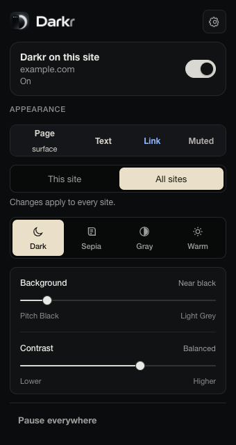
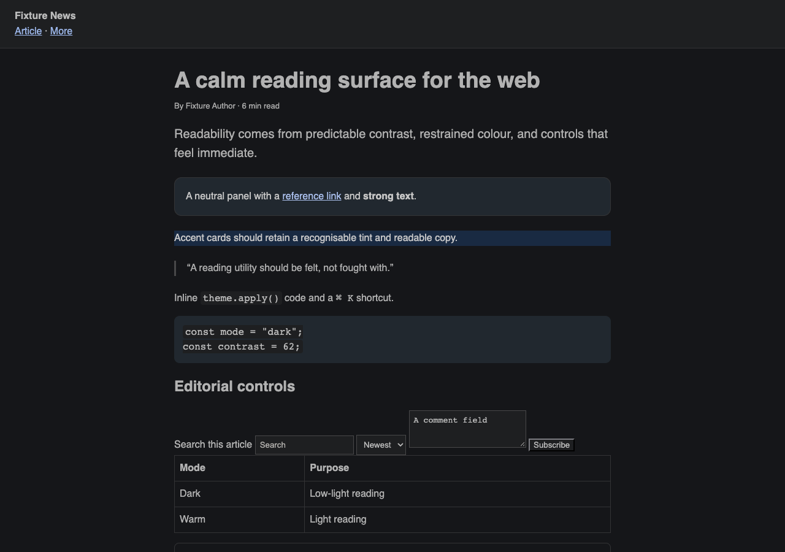

# Darkr for Chrome

Darkr is a local-first reading utility that adjusts webpage appearance without
replacing the page. It offers Dark, Sepia, Grayscale and Warm Light modes with
live controls, global defaults, and per-site overrides. One switch turns Darkr
on or off for the site you are on.





No account, no analytics, no network requests. See [docs/PRIVACY.md](docs/PRIVACY.md).

## Requirements

- Node.js 20 or newer
- Chrome 109 or newer

## Develop

```sh
npm ci
npm run build          # → dist/chrome-extension
npm run build:watch
```

Open `chrome://extensions`, enable Developer mode, choose **Load unpacked**, and
select `dist/chrome-extension`.

## Test

```sh
npm run check          # typecheck, lint, unit/DOM tests, package, manifest checks
npm run lint           # Biome lint + format check (npm run format to fix)
npm run test:e2e       # Chromium end-to-end suite (also runs in CI)
npm run check:all      # check + popup contrast + e2e
npm run test:perf      # startup and long-page timings
```

See [docs/TESTING.md](docs/TESTING.md) for the manual matrix.

## Package

```sh
npm run package
```

Outputs `dist/releases/darkr-chrome-v<version>.zip` with `manifest.json` at the
archive root, ready for the Chrome Web Store, and an unpacked folder with
install notes.

## Layout

| Path | Purpose |
| --- | --- |
| `src/content/` | Page theming engine (content script) |
| `src/popup/`, `src/options/`, `src/welcome/` | Toolbar popup, settings page, first-run welcome page |
| `src/background/` | Service worker (welcome page, toolbar badge, keyboard shortcuts, top-site lookup for frames) |
| `src/_locales/` | Manifest strings (English) |
| `tests/e2e/` | Browser test cases and fixtures (`tests/fixtures/`) |
| `src/shared/` | Colour math, theme tokens, preference model |
| `build.mjs` | esbuild bundler; `DARKR_MANIFEST`, `DARKR_OUT`, `DARKR_BROWSERS` let other hosts reuse the sources |

## Permissions

- `storage` persists global and per-domain settings locally.
- `scripting` injects Darkr into tabs that were already open when it was
  installed or updated, so they work without a reload. It is used for nothing else.
- Host access to `http://` and `https://` pages lets Darkr read computed colors
  and apply a visual theme. Page text, history, and form contents are never read
  or transmitted.

## Domain matching

Preferences are keyed by exact hostname. A setting for `example.com` does not
apply to `docs.example.com` unless that rule has **Include subdomains** ticked in
Settings (an exact rule on the subdomain always wins). The `www.` alias is normalized only when doing so
leaves a valid hostname, so `www.example.com` shares `example.com` while
`www.com` remains distinct. IPv6 hosts are preserved.

Site entries store only fields that differ from global defaults. Each saved site
can also carry one of three policies. The popup's switch sets **Never** (off) or
back to **Automatic**; **Always** is set from Settings:

- **Automatic** (the default for every site) follows the global on/off switch,
  or — if you choose *System appearance* in Settings — themes only while your
  operating system is in dark mode.
- **Always** themes the site even while Darkr is paused or the system is light.
- **Never** leaves the site untouched.

### Embedded frames

The site in the address bar governs everything embedded in it. A page's policy,
site overrides and native-dark choice apply to all of its frames, whichever host
a frame is served from, so setting a site to **Never** also leaves an embedded
document viewer or video player on another host untouched. A frame's own
hostname is never consulted. Frames without a network address of their own
(`about:blank`, `srcdoc`, `blob:`, `data:`) are covered too, so they match the
page around them.

Darkr finds the top-level site from `location.ancestorOrigins` where the browser
provides it, and otherwise by asking its background script, which reads the
tab's URL. Nothing is sent anywhere outside the browser.

To avoid a flash of the unthemed page, the top document is briefly held at
`document_start` until your preferences have loaded (with a 250 ms safety
timeout so a stalled storage call can never leave a page blank). Embedded
frames are not held.

## Shortcuts and toolbar

- <kbd>Alt</kbd>+<kbd>Shift</kbd>+<kbd>D</kbd> turns Darkr on or off for the
  current site; <kbd>Alt</kbd>+<kbd>Shift</kbd>+<kbd>P</kbd> pauses or resumes
  it everywhere. Rebind them at `chrome://extensions/shortcuts`.
- The toolbar icon shows an **off** badge on tabs where Darkr is off for the
  site or paused.
- Printing and forced-colors (high-contrast) modes are left untouched.

## Appearance modes

- **Dark** uses semantic surface and text mapping with a continuous background
  tone and contrast control. The left endpoint is true `#000000` for OLED
  displays; raised surfaces remain subtly separated.
- **Sepia** uses a warm parchment surface palette and adjustable intensity.
- **Grayscale** uses a root-level CSS filter. It intentionally affects images,
  video, and canvas content.
- **Warm Light** shifts light surfaces and foregrounds toward a warm tone
  without turning the page dark.
Turning Darkr off for a site removes injected styles, attributes, observers and
filters from it.

Pages that already have a dark appearance are left untouched except for an
explicitly selected grayscale effect.

## Known limitations

- Canvas-rendered applications cannot be recolored. Frames are themed by their
  own copy of Darkr, following the top-level site's rule.
- Gradients and images are not remapped; text over them is kept readable
  instead. Hover, focus and active colours are themed only when they come from
  style sheets the browser lets Darkr read (same-origin or CORS-enabled);
  cross-origin sheets would need a network fetch, which Darkr never makes.
- Closed shadow roots cannot be styled. Open shadow roots receive a style sheet.
- Some sites use inline styles or third-party widgets that do not expose stable
  semantic colors; Darkr preserves author inline edits rather than repeatedly
  overriding them.
- Restricted pages (`chrome://`, the Web Store) are not supported.
- Shadow roots attached after their host was inspected are not picked up until
  the page is refreshed.
